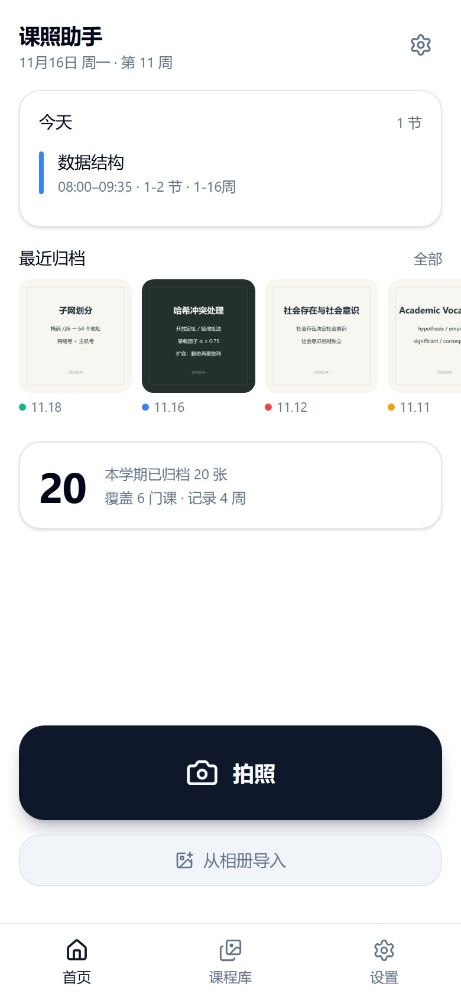
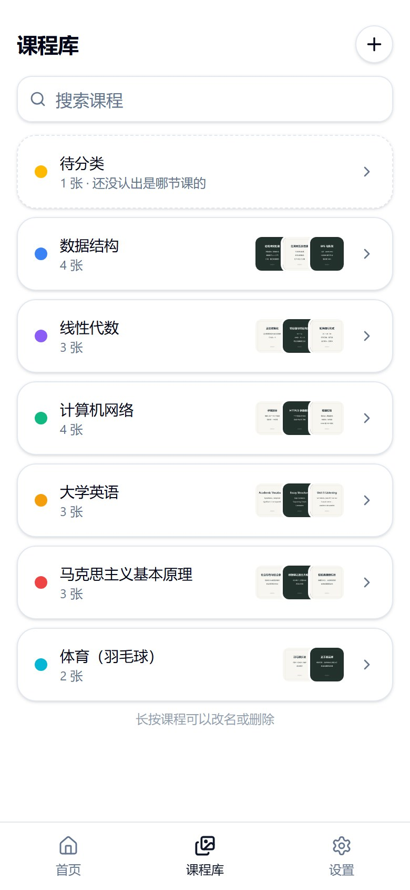
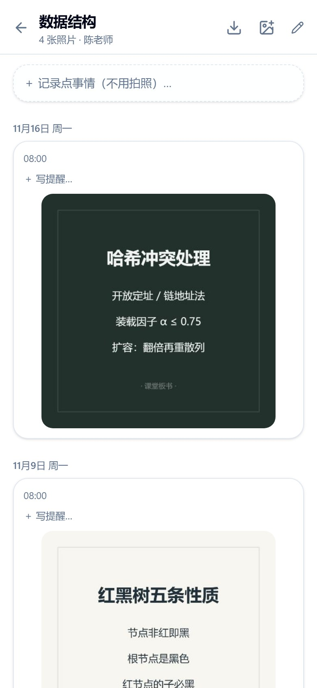
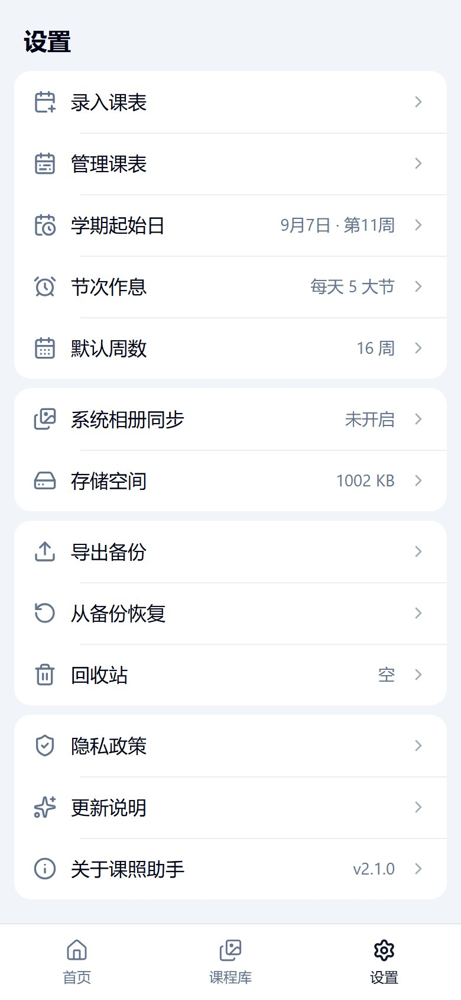

# 课照助手（Kezhao Assistant）

> 拍完板书不用管：打开即已按课程、按日期归档好的课堂照片助手

<p align="center">
  
  
  
</p>

大学生拍板书/PPT，一学期几百张混在相册里，考前找不到。课照助手把「照片拍摄时间」和「课表」对齐——拍完自动归入对应课程，复习时来课程库找，整整齐齐。

**v2 是彻底离线版**：APK 只声明相机权限，`INTERNET` / `REQUEST_INSTALL_PACKAGES` 在 Manifest 里被显式移除（`tools:node="remove"`），无账号、无云同步、无统计 SDK、无更新检查。照片和课表只存在手机本地。

| 最新版本 | 平台 | 下载 | 包体 | 许可 |
|---|---|---|---|---|
| v2.1.0 | Android 8.0+（Capacitor 8 壳） | [Releases 下载 APK](https://github.com/biubiukangkang/kezhao-assistant/releases) | 约 7 MB | MIT |

另有参赛网页版（QMuse 平台构建）：<https://qmuse.cn/app/2147940046996490>

## ✨ 功能特性

- **拍照即归档**：调系统相机拍摄，按拍摄时间 × 课表自动识别课程，第一张确认后连拍免打扰；课间/课前拍摄有专门的方向判定
- **课表引擎**：周视图管理（任意周次组合 / 单双周 / 冲突提醒）；教务 `.xls/.xlsx` 导入、文本粘贴导入、**AI 转课表向导**（复制提示词 → 丢给任意 AI 转换 → 粘贴结果，App 本身不联网）
- **QQ 空间式课程相册**：日期分组动态流、备注提醒、星标重点板书、沉浸查看器、待分类批量改派
- **数据主权**：IndexedDB 本地优先；系统相册按课程子文件夹自动镜像（免权限）；流式 JSON 整包备份 / 原子恢复；回收站 30 天可恢复；照片批量导出、分享
- **首次启动隐私政策**：说清「不联网、不收集、卸载即清空」后才进入应用
- 适配深色模式、刘海安全区；锁定字体缩放，系统大字体不破版

<p align="center">
  
</p>

## 🛠 技术栈

`React 19` · `Vite 7` · `TanStack Router`（hash history）· `Tailwind 4` · `IndexedDB (idb)` · `exifr` · `Capacitor 8`（安卓壳 + 原生 MediaStore/相机插件）· `vitest` · `oxlint`

- **88 个单元测试**：课表解析、时间匹配、备份恢复、设置合并等核心逻辑全覆盖
- **离线审计**：`npm run audit:offline` 扫描产物里的网络调用与 APK 权限清单，必须 PASS 才发版
- 架构与设计决策见 [docs/技术方案.md](docs/技术方案.md)，需求演进见 [docs/PRD.md](docs/PRD.md)，踩坑记录见 [docs/踩坑日志.md](docs/踩坑日志.md)

## 🚀 快速开始

### 安卓 APP（推荐）

从 [Releases](https://github.com/biubiukangkang/kezhao-assistant/releases) 下载最新 APK 安装即可。v2 起不内置更新检查，升级方式为下载新 APK **覆盖安装**，数据全部保留。

### 从源码构建

```bash
git clone https://github.com/biubiukangkang/kezhao-assistant.git
cd kezhao-assistant
npm install                 # xlsx 走 vendor/xlsx-0.20.3.tgz，勿改 npm 源版本
npm run dev                 # 网页版开发（http://127.0.0.1:5173）
npm run check               # tsr generate + oxlint + tsc，提交前必跑
npm run test                # vitest，88 条
npm run audit:offline       # 离线审计，必须 PASS
```

安卓 APK（需 JDK 21 + Android SDK）：

```bash
npm run app:debug    # 调试 APK
npm run app:release  # 自签 release APK（读 android/keystore.properties 签名）
```

- 签名文件 `android/keystore.properties` 与 `*.keystore` 不入库；自行构建请生成自己的签名（**签名丢失将无法覆盖升级**）
- 仓库不含任何密钥，AI 转课表不依赖 App 内置的接口密钥

## 🤝 贡献约定

改代码前读 `docs/技术方案.md`：路由保持平铺（禁 pathless layout）、根布局不挂全局组件、照片一律经 `lib/archive.ts` 入库、安卓 `.java` 源文件 ASCII-only、`server.androidScheme` 永不改。

## 📄 许可证

MIT

> 截图中的课程、课表与板书均为演示数据。
